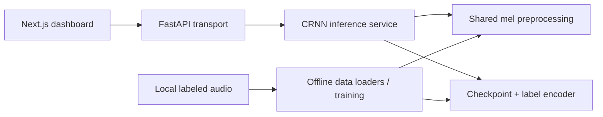

# Architecture

The repository contains two deployable applications and an offline training workflow.
Vercel's configured root remains `frontend/`. Railway and the Procfile keep `backend:app`.
The refactor preserves checkpoint tensor names, label order, and preprocessing dimensions.

## Python boundaries

- `api/app.py` owns HTTP validation, CORS, startup loading, status codes, and temporary upload
  cleanup. `create_app` accepts a detector factory for isolated API tests. It loads one detector
  per worker at startup and does not retry synchronous loading on every request.
- `ml/inference.py` owns checkpoint validation and prediction. `predict_details` returns class,
  location, and model softmax confidence; `predict` retains the original tuple contract for
  the local Streamlit adapter. Grouped labels retain their system names.
- `audio/preprocessing.py` is shared by training and inference. Stochastic augmented samples
  are no longer cached. Deterministic dataset reads may use the feature cache; uploads do not.
- `ml/model.py` preserves the existing network architecture. Weight loading is strict and uses
  `weights_only=True`. A partial/randomly initialized model must not report readiness.
- `ml/data_loader.py`, `ml/train.py`, and `ml/evaluate.py` keep training separate from request
  handling. Undecodable training samples now fail instead of becoming labeled zero arrays.
- `data/` owns inventory, physical split organization, and import/merge utilities. Merge paths
  use configuration instead of a developer's hardcoded Windows directories. The organizer
  checks relative split directories rather than searching absolute paths for “train/test”.
- `config.py` provides the existing hyperparameters/mappings and configurable paths. Imports
  do not create directories; training and cache writes create their own outputs explicitly.

`pyproject.toml` is the dependency source. Runtime, optional training/dashboard tools, and
checks have separate dependency groups. Root modules are thin compatibility adapters; new
internal imports use package-qualified names. Model artifacts remain in their existing paths.

## Frontend boundaries

- `src/pages/` provides Next.js entry points.
- `features/diagnostics/DiagnosticDashboard.js` composes the existing dashboard layout.
- `useDiagnosticSession.js` owns uploads, recording, preview cleanup, health checks, theme,
  session history, and measured request timing. Recorder resources are stopped on unmount.
- `panels.js` contains result, statistics, session records, and settings views. Nonfunctional
  sensitivity/encryption/alert switches and fabricated statistics were removed.
- `lib/api.mjs` owns HTTP configuration through `NEXT_PUBLIC_API_URL`.
- `lib/audio.js` owns mono PCM WAV conversion and closes its AudioContext on errors.
- `lib/metrics.mjs` validates/aggregates confidence and timing; absent confidence stays absent.

History remains in browser memory and is explicitly labeled as session history. The UI's
waiting animation does not claim to report backend processing stages. Native sidebar buttons
provide keyboard interaction. Styles are centralized in `src/styles/globals.css`.

## Configuration and deployment

Path defaults are relative to the working directory (launch from the checkout root).
`CAR_FAULT_PROJECT_ROOT` selects another root; `DATASET_DIR`, `MODELS_DIR`, `RESULTS_DIR`, and
`UNPROCESSED_DATA_DIR` can override individual locations. CORS uses the comma-separated
`ALLOWED_ORIGINS` setting, defaulting to `http://localhost:3000`.

- `GET /` retains the existing health response contract.
- `GET /health` is liveness; it returns 200 even if model initialization failed.
- `GET /ready` returns 503 unless the checkpoint has loaded successfully.
- `POST /predict` returns the existing fields plus `confidence` in `[0, 1]`; malformed audio
  yields 422, oversize audio 413, and an unavailable model 503. Uploads are removed on failure.
- `GET /classes` returns loaded labels and the mapping; it yields 503 without a detector.

The Procfile and Railway configuration now agree on one worker to avoid duplicating model
memory. Dependencies use compatibility bounds; production releases still need a tested Python
lock/snapshot. This refactor does not upgrade the Next.js major version or change trained weights.
